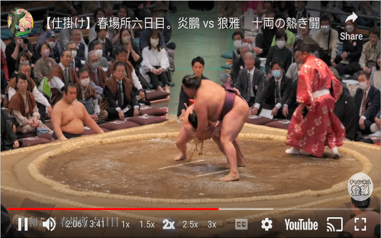
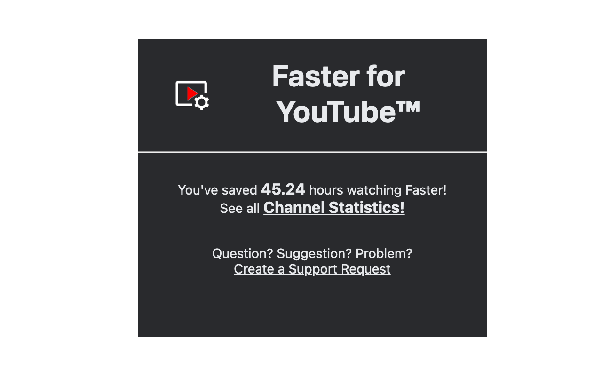
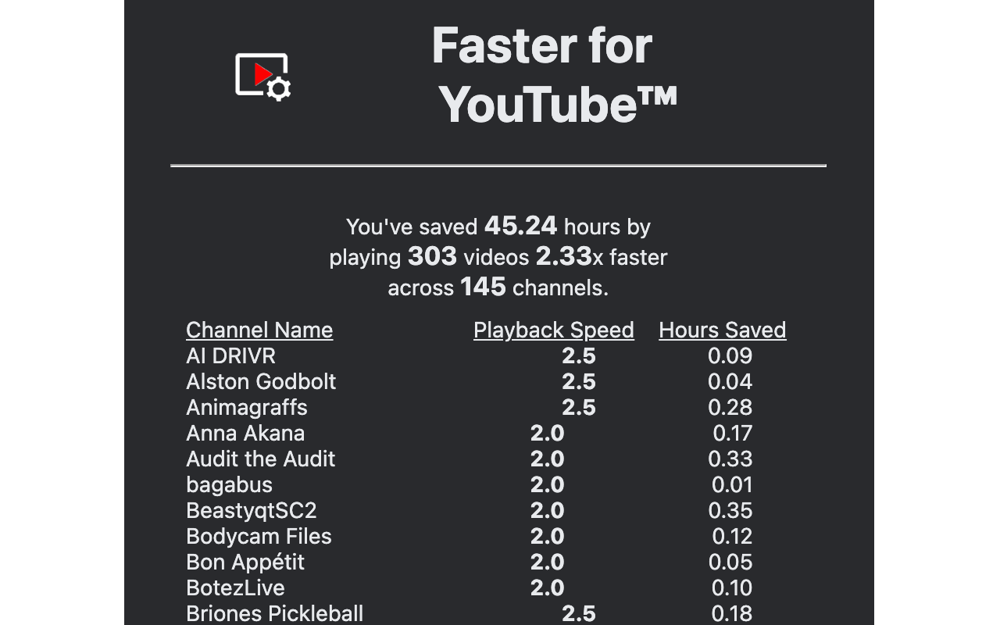

# Faster For YouTube

Play YouTube videos faster and remember your speed settings per channel.

**[Install for Chrome](https://chrome.google.com/webstore/detail/faster-for-youtube)** · **[Install for Firefox](https://addons.mozilla.org/firefox/addon/faster-for-youtube/)** · [Website](https://ffyt.17324552263.com/) · [Release Notes](docs/release.md) · [Privacy Policy](docs/privacy.md)

---

## Features

### Speed Controls on Every Video
Buttons appear directly in the YouTube player — tap to change speed instantly. Works on embedded videos and smaller devices.




### Popup — Time Saved at a Glance
Click the extension icon to see total time saved across all channels, with a full breakdown by weeks, days, hours, and minutes.



### Channel Statistics
View time saved grouped by channel. Speeds are stored per-channel and remembered across sessions. Includes a watching activity heatmap and a milestone summary card.



### Milestones
Earn badges as you watch — across six categories: Time Saved, Videos, Channels, Streaks, Active Days, and Channel Depth. Your highest-earned badge per category shows in the popup. Channel Depth tracks how deeply you've watched a single creator and appears inline in the channel table and popup.

### Watching Activity Heatmap
A GitHub-style heatmap on the Channel Statistics page shows your daily watching history over the past year, with date and time saved on hover.

---

## Install

| Browser | Link |
|---------|------|
| Chrome / Edge / Chromium | [Chrome Web Store](https://chrome.google.com/webstore/detail/faster-for-youtube) |
| Firefox | [Firefox Add-ons (AMO)](https://addons.mozilla.org/firefox/addon/faster-for-youtube/) |

**No account required. No data collected.** All stats stay in your local browser storage.

---

## Get Started (Local Development)

No build tools or dependencies are required — the extension runs directly from `src/`.

### Chrome / Chromium
1. Go to `chrome://extensions`
2. Enable **Developer mode** (toggle, top right)
3. Click **Load unpacked** → select the `src/` folder

### Firefox
Firefox requires a zip due to macOS file access restrictions.

1. Run `make dev` to build the zip
2. Go to `about:debugging#/runtime/this-firefox`
3. Click **Load Temporary Add-on** → select the zip from `dist/`

> Temporary add-ons are removed when Firefox closes. For a persistent install, use a [signed or unlisted build](https://extensionworkshop.com/documentation/publish/).

---

## Latest Release

### 0.6.3 — 2026.03.21
- Real-time watch time updates no longer show extra spacing during playback
- Channel time-saved cells no longer flash unexpectedly while a video is playing

### 0.6.2 — 2026.03.21
- Milestones system with badges across six categories: Time Saved, Videos, Channels, Streaks, Active Days, Channel Depth
- Channel Depth tier shown per channel in the table and in the popup when on a channel's video
- Watching activity heatmap month labels at actual month start
- Full milestones page with earned dates and channel counts for depth tiers

[View full release notes →](docs/release.md)

---

## Development

### Project Structure

```
src/
  content/     # Injected into YouTube pages
  public/      # Popup and Channel Statistics pages
  service/     # Background service worker
  test/        # In-browser test runner (test/index.html)
```

**`content/`**
- `controls` — Speed buttons rendered inside the video player
- `statistics` — 1-second interval that logs time saved while watching
- `inject` — Injects a script into the page DOM to access YouTube's JS objects
- `extract` — The injected script; retrieves and posts data back to the content script

**`public/`**
- `index` — Popup shown when the extension icon is clicked
- `channels` — Channel Statistics page with per-channel breakdown, heatmap, and milestone summary
- `milestones` — Full milestones page listing all badges with earned dates and channel counts
- `milestones.js` — Milestone definitions, SVGs, evaluation logic, and `depthTierFor()` helper
- `utils.js` — Shared formatting and animation utilities

**`service/`**
- `background` — Service worker that handles events and stores stats

### Building

The version is read from `manifest.json` — update it there before building.

```bash
make dev      # includes test/ — devtools and test runner accessible in Firefox
make release  # strips test/ — ready to submit to stores
```

Both zips work for Firefox (`about:debugging`) and Chrome (`chrome://extensions`). The same release zip can be submitted to both stores.

### Submitting to Stores

| Store | Dashboard | Notes |
|-------|-----------|-------|
| Chrome Web Store | [Developer Dashboard](https://chrome.google.com/webstore/devconsole) | Upload zip under the existing listing |
| Firefox Add-ons | [Developer Hub](https://addons.mozilla.org/developers/) | `gecko.id` in `manifest.json` ties it to your account |

### Running Tests

Open `src/test/index.html` in a browser (or load via the dev build in Firefox DevTools). The in-browser test runner covers `channels.js`, `utils.js`, and `data/builder.js` with no external dependencies.

---

## Architecture

### Chrome Extension Contexts

There are five execution contexts, each with different access:

| Context | What it can access |
|---------|-------------------|
| Popup page | Chrome API, extension storage |
| Extension pages (e.g. Channel Stats) | Chrome API, extension storage |
| Content Scripts | Page DOM, Chrome messaging — isolated JS environment |
| Web Accessible Resources | Page JS objects — no Chrome API |
| Background service worker | Full Chrome API, persistent\* across tabs |

\* Event-driven — the worker may sleep when idle, unloading local variables.

### Message Flow

```
YouTube page
  └─ extract.js (WAR)        window.postMessage →
       inject.js (content)   chrome.runtime.sendMessage →
         background.js       chrome.storage.local.set
                             chrome.tabs.sendMessage →
           popup / channels  (read stats, render)
```

- Popup, extension pages, and the background worker can send messages to each other and to specific tabs.
- Content scripts can send messages extension-wide.
- Web Accessible Resources run inside the page and can only use `window.postMessage`, interceptable by any listener on that page.

### Principles

- **No data collection.** All data stays on the user's machine and is never transmitted.
- **No dependencies.** The codebase is plain HTML/CSS/JS — no build step, no npm, no frameworks.
